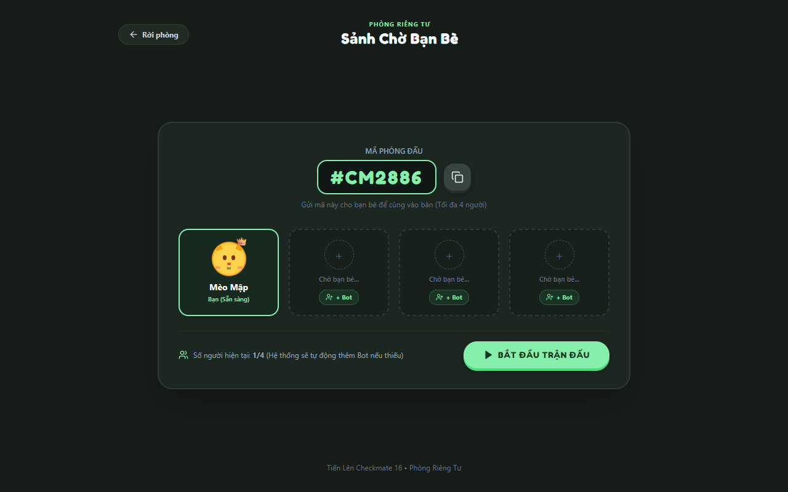
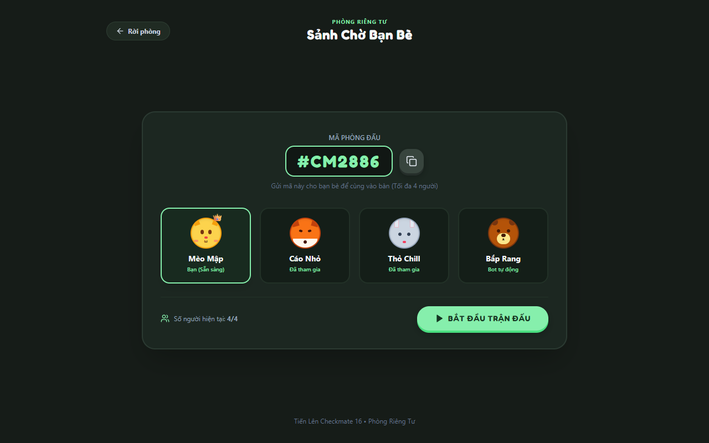
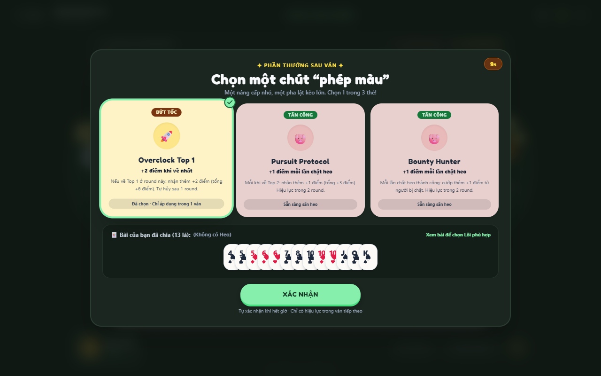
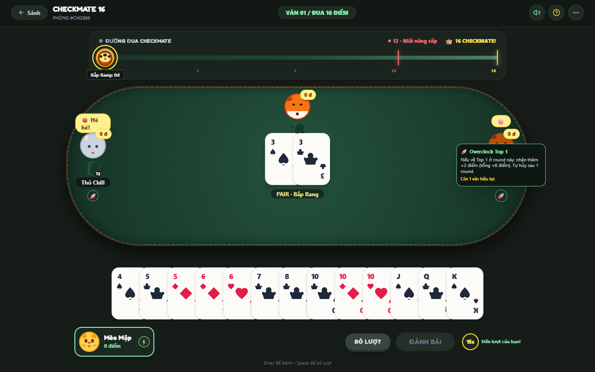
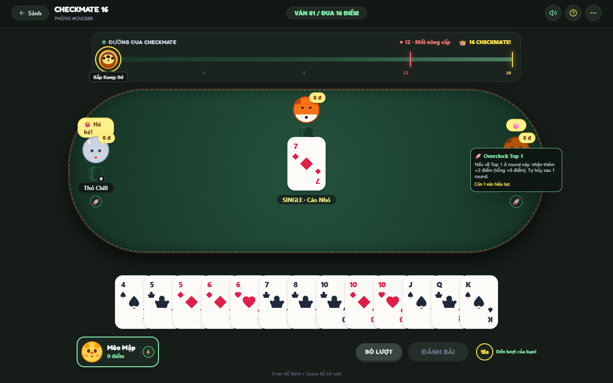

# 🃏 TIẾN LÊN CHECKMATE 16 & ROGUELIKE AUGMENTS
### 🎲 Phong Cách Cozy Discord "Poker Night" Party Game

[](https://opensource.org/licenses/MIT)
[](https://nodejs.org/)
[](https://react.dev/)
[](https://socket.io/)
[](https://tailwindcss.com/)
[](https://prisma.io/)

Game bài **Tiến Lên Miền Nam** kết hợp thể thức **Checkmate 16 Điểm**, cơ chế **Chọn Lõi Điểm Số (Point Augments)**, **Luật Cân Bằng 12 Điểm (Đánh Chay)** và hệ thống **Sảnh Chờ Bạn Bè (Multiplayer)**. Giao diện được thiết kế theo phong cách **Cozy Discord "Poker Night"** ấm cúng, thư giãn với các Avatar thú cưng đáng yêu và tương tác thẻ bài mượt mà.

---

## 📸 HÌNH ẢNH THỰC CHIẾN (CHỤP TỰ ĐỘNG BẰNG PLAYWRIGHT)

### 1. Sảnh Chờ Phòng Riêng (Private Waiting Room)
Tạo phòng với mã riêng biệt (ví dụ: `#CM2886`), hỗ trợ mời bạn bè tham gia hoặc thêm Bot tự động vào các ghế trống:


### 2. Sảnh Chờ Đầy Đủ 4 Người Chơi
Hỗ trợ cả người chơi thật kết nối qua WebSocket realtime và Bot AI điền chỗ trống:


### 3. Chọn Lõi Thần Kỳ & Xem Trước Bài Đã Chia
Sau khi chia bài, người chơi có 10 giây xem trước **13 lá bài của mình** ở chân trang để chọn 1 trong 3 Lõi tối ưu chiến thuật:


### 4. Bàn Đấu Bài Phong Cách Cozy Discord "Poker Night"
Bàn nỉ xanh lá mượt mà (`#1e5638`), thanh đường đua Checkmate 16 điểm trên đỉnh cùng các nút bấm Squishy mềm mại:


### 5. Bảng Tổng Kết & Cộng Điểm Sau Ván
Phân hạng từ #1 đến #4, cộng điểm thứ hạng (+4đ, +2đ, +1đ, 0đ), kích hoạt Lõi và tính điểm cướp/phạt chặt heo:


---

## 🎮 CƠ CHẾ GAMEPLAY & LUẬT CHƠI ĐẶC SẮC

### 👑 1. Luật Checkmate 16 Điểm (Đua Điểm Marathon)
* Mỗi ván bài kết thúc: Top 1 (+4đ), Top 2 (+2đ), Top 3 (+1đ), Top 4 (0đ).
* **Ăn Trắng (Tới Trắng)**: Tự động giành Top 1 nhận **+5 điểm**, 3 người còn lại tiếp tục đánh để phân định Top 2, 3, 4.
* **Match Point**: Khi có ít nhất 1 người chơi đạt $\ge 16$ điểm, trận đấu kích hoạt trạng thái **CHECKMATE**.
* **Điều kiện Vô Địch Toàn Trận**: Trận đấu chỉ kết thúc khi một người chơi $\ge 16$ điểm giành chiến thắng **Top 1** trong round đó!

### ⚡ 2. Luật Cân Bằng 12 Điểm (Handicap / Đánh Chay)
* Khi người chơi đạt $\ge 12$ điểm: Toàn bộ Lõi đang sở hữu sẽ bị **tước sạch**.
* Ở các ván tiếp theo, người này **không được chọn Lõi nữa** mà phải đánh chay, tạo cơ hội cho đối thủ dưới 12 điểm lội ngược dòng.

### 🐷 3. Quy Chuẩn Chặt Heo & Cướp Điểm
* **Heo lớn đè Heo nhỏ**: Là nước đi bình thường theo luật TLMN, **không tính chặt và không cướp điểm**.
* **Chặt Heo bằng Hàng**: Chỉ khi dùng **Ba Đôi Thông**, **Tứ Quý** hoặc **Bốn Đôi Thông** chặt Heo/chặt Hàng mới tính là Chặt Heo:
  * Chặt Heo Đen: Cướp 1 điểm trực tiếp.
  * Chặt Heo Đỏ: Cướp 2 điểm trực tiếp.
  * Chặt Ba Đôi Thông: Cướp 2 điểm trực tiếp.
  * Chặt Tứ Quý: Cướp 3 điểm trực tiếp.
  * Chặt Bốn Đôi Thông: Cướp 4 điểm trực tiếp.
* **Thối Heo / Hàng cuối ván**: Người thối heo bị trừ điểm phạt chuyển thẳng cho người về Top 1 của round.

### 🍀 4. Danh Mục Lõi Điểm Số (Augments)
| Hệ | Thẻ Lõi | Thời Hạn | Hiệu Ứng |
| :---: | :--- | :---: | :--- |
| 🚀 **Bứt Tốc** | **Overclock Top 1** | 1 ván | Về Top 1 nhận thêm +2 điểm thưởng (tổng +6 điểm). |
| 🚀 **Bứt Tốc** | **Pursuit Protocol** | 2 ván | Về Top 2 nhận thêm +1 điểm thưởng (tổng +3 điểm). |
| 🚀 **Bứt Tốc** | **Hyper Roulette** | 1 ván | Cược lớn: Về Top 1 nhận +7 điểm; không về Top 1 nhận 0 điểm bất kể thứ hạng. |
| 🐷 **Tấn Công** | **Bounty Hunter** | 2 ván | Mỗi lần chặt heo thành công, cướp thêm +1 điểm từ người bị chặt. |
| 🛡️ **Phòng Thủ** | **Emergency Shield** | 1 ván | Nếu về Top 4 (chót), nhận ngay +1 điểm an ủi bảo hiểm. |
| 🛡️ **Phòng Thủ** | **Stealth Matrix** | 2 ván | Về Top 2 hoặc Top 3 nhận thêm +1 điểm thưởng sinh tồn. |
| 🛡️ **Phòng Thủ** | **Zero Threat** | 1 ván | Nếu trong ván không chặt ai và không bị ai chặt, nhận +1 điểm hòa bình. |

---

## 🎨 THIẾT KẾ ĐỒ HỌA: COZY DISCORD "POKER NIGHT"

* **Bảng màu ấm cúng**: Nền than trầm `#121814`, sảnh tối `#161c18` kết hợp mặt bàn nỉ xanh `#1e5638` và viền gỗ nâu `#784f30`.
* **Nút bấm Squishy**: Hiệu ứng nhún đàn hồi khi bấm (`btn-squish-green` `#86efac`, `btn-squish-gray`).
* **Avatar Thú Cưng**: Bộ avatar đáng yêu gồm Mèo Mập 🐱, Gấu Bắp Rang 🐻, Cáo Nhỏ 🦊, Thỏ Chill 🐰.
* **Bộ bài ngà kem**: Nền trắng kem bo góc mềm mại, hiển thị rõ số và chất; quân Heo 2 điểm xuyết vương miện 👑 nhỏ tinh tế.
* **Đường đua Checkmate**: Avatar các con thú di chuyển dọc đường đua 16 điểm cùng vạch kẻ cảnh báo 12 điểm "Mất nâng cấp".

---

## 🏗️ KIẾN TRÚC MÁY CHỦ ĐỒNG NHẤT (UNIFIED SERVER)

Hệ thống sử dụng kiến trúc máy chủ đơn cổng (port `3001`):
* **Express & Socket.io**: Phục vụ cả REST API (`/api/auth/*`, `/api/admin/*`, `/api/health`), Web SPA và kết nối WebSocket realtime.
* **Tương thích kép**:
  * Chạy trực tiếp qua Node.js: `http://localhost:3001`
  * Chạy tích hợp qua Apache WampServer: `http://localhost/tienlen` (tự động liên kết Socket.io tới port 3001).
* **MySQL & Prisma ORM**: Tự động kiểm tra và khởi tạo cơ sở dữ liệu `tienlen_checkmate` cùng tài khoản Admin mặc định khi khởi chạy.

### 🔑 Tài khoản Quản trị viên (Admin):
* **Username**: `admin`
* **Password**: `admin123`
* Bấm nút **QUẢN TRỊ** trên thanh tiêu đề để mở Admin Dashboard: xem người dùng, khóa/mở khóa tài khoản (Ban/Unban), phân quyền Role (`USER` / `ADMIN`) và xem thống kê trận đấu.

---

## 🚀 HƯỚNG DẪN CÀI ĐẶT & CHẠY DỰ ÁN

### 1. Cài đặt Dependencies
```bash
# Cài đặt toàn bộ dependencies gốc và các gói con
npm install
cd server && npm install
cd ../client && npm install
```

### 2. Cấu hình Cơ sở dữ liệu (MySQL)
Đảm bảo dịch vụ MySQL đang chạy (ví dụ qua WAMP/XAMPP trên port 3306, user `root`, mật khẩu rỗng).
Hoặc import trực tiếp file [tienlen_checkmate.sql](tienlen_checkmate.sql) vào phpMyAdmin.

### 3. Build & Khởi động Server
```bash
# Build frontend client vào thư mục public/
npm run build

# Khởi động Backend Socket & Web Server
cd server
npm run dev
```

Mở trình duyệt truy cập ngay:
👉 **`http://localhost:3001`** hoặc **`http://localhost/tienlen`**

---

## 🧪 CHẠY BỘ KIỂM THỬ (TEST SUITES)

Dự án có sẵn 2 bộ test tự động 100% bằng TypeScript và Playwright:
```bash
# 1. Kiểm thử Core Engine (Luật bài, chặt heo, handicap 12đ, checkmate 16đ)
npx tsx server/src/engine/engine.test.ts

# 2. Kiểm thử tự động giao diện & kịch bản 4 người chơi với Playwright
npx playwright test
```

---

## 📄 BẢN QUYỀN
Phát triển theo giấy phép [MIT License](LICENSE).
Tận hưởng những ván bài Tiến Lên kịch tính và lật kèo ngoạn mục cùng hội bạn bè! ☕🃏
